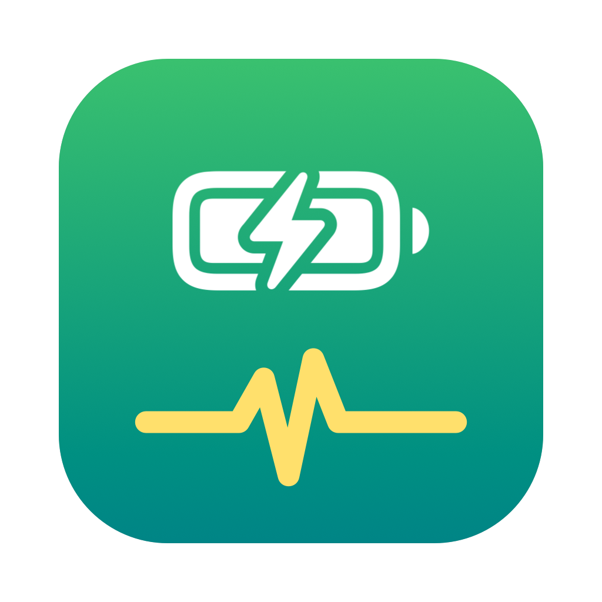

<p align="center"></p>

# BatteryHealth

A macOS menu bar app that shows the health of your MacBook battery and the charge of your
wireless devices and iPhone in one place, and warns you before something runs out or wears out.
Sister project of [DiskHealth](https://github.com/AccessDenied80/DiskHealth).

> Available in English and Ukrainian (follows the macOS language). Опис українською — [нижче](#українською).

## What it shows

| Source | Data | How |
|---|---|---|
| **MacBook battery** | health %, capacity vs design (mAh), cycles vs rated cycles, condition reported by macOS, charge, temperature, voltage per cell, current, power adapter | IOKit `AppleSmartBattery` + IOPS |
| **iPhone** (USB or Wi-Fi sync) | charge, battery health %, capacity, cycle count | `MobileDevice.framework` + diagnostics relay |
| **AirPods** | left / right / case charge | `system_profiler SPBluetoothDataType` |
| **Magic Mouse / Keyboard / Trackpad** | charge | IOKit HID `BatteryPercent` |
| **Game controllers** | charge | GameController framework |

No administrator password and no helper tools — everything is read as a normal user.

### Notifications (once per event)

- Mac battery health below 80 %, or macOS recommends service
- Mac battery temperature ≥ 45 °C
- A device at or below 15 % charge (repeats only after it has been charged)
- iPhone battery health below 80 %

All thresholds are configurable. History (365 days) feeds the health and cycle charts.

## Install

1. Download `BatteryHealth-<version>.dmg` from [Releases](../../releases) and drag **BatteryHealth** to **Applications**.
2. The app is not notarized by Apple (ad-hoc signed), so macOS blocks the first launch.
   Open **System Settings → Privacy & Security** and click **Open Anyway**, or run:
   ```bash
   xattr -dr com.apple.quarantine /Applications/BatteryHealth.app
   ```
3. Allow notifications when asked. The app lives in the menu bar.

**iPhone:** connect it with a cable once and tap **Trust** on the phone. To see it without a cable, enable
*Show this iPhone when on Wi-Fi* in Finder.

Requires macOS 13 Ventura or later; universal build for Apple Silicon and Intel.

## Limitations

- **iPhone data uses Apple's private `MobileDevice.framework`** (the same one Finder uses). It works on current
  macOS/iOS versions but is undocumented and may change.
- **Apple Watch** is not supported — its battery is not reachable from a Mac.
- Third-party Bluetooth headphones appear only if macOS itself knows their battery level.
- Charge limiting (e.g. stop at 80 %) is out of scope: it needs root access to the SMC.

## Build from source

Only the Xcode Command Line Tools are needed.

```bash
scripts/build-app.sh --dmg       # build/BatteryHealth.app and build/BatteryHealth-<version>.dmg
scripts/test.sh                  # unit tests (swift-testing)
swift scripts/make-icon.swift    # regenerate the icon
```

Debug builds also support `--dump` (print all parsed data as JSON) and `--snapshot <dir>` (render windows to PNG).
`spikes/iphone-battery.swift` documents the iPhone protocol.

Data is stored in `~/Library/Application Support/BatteryHealth/`.

## License

[MIT](LICENSE)

---

## Українською

**BatteryHealth** — застосунок у рядку меню macOS: здоров'я батареї MacBook (ємність, цикли, стан від macOS,
температура, напруга комірок), заряд AirPods, миші, клавіатури, геймпада, а також заряд і знос батареї iPhone —
і сповіщення, коли щось розряджається або зношується. Без прав адміністратора.

**Встановлення.** Завантажте `BatteryHealth-<версія>.dmg` з [Releases](../../releases), перетягніть застосунок у
«Програми». Під час першого запуску відкрийте **Системні параметри → Конфіденційність і безпека → «Все одно відкрити»**.
iPhone: один раз підключіть кабелем і натисніть «Довіряти»; для Wi-Fi увімкніть у Finder «Показувати цей iPhone
в мережі Wi-Fi».

**Збирання:** `scripts/build-app.sh --dmg`. Тести — `scripts/test.sh`.
